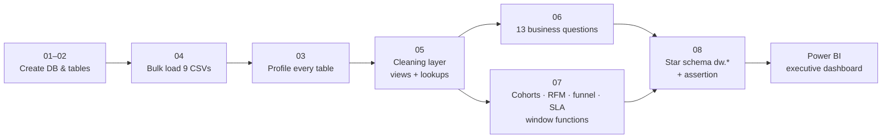

# Olist Brazilian E-Commerce — SQL Analytics & Power BI Dashboard

End-to-end analytics project on the [Olist Brazilian E-Commerce dataset](https://www.kaggle.com/datasets/olistbr/brazilian-ecommerce)
(~100k orders, 9 relational tables, 1.4M rows, 2016–2018). Built in **PostgreSQL**, modelled into a **star schema**,
and visualised in **Power BI**.

Olist is a Brazilian marketplace that lets small sellers list on large retail sites. The dataset contains every order,
item, payment, review and delivery timestamp from Sep 2016 to Oct 2018. This project asks the questions an analyst at
Olist would be asked — *where is revenue coming from, why are customers unhappy, and why don't they come back* — and
answers them with reproducible SQL.


---

## Contents

1. [Headline numbers](#headline-numbers)
2. [Key findings](#key-findings)
3. [Recommendations](#recommendations)
4. [Pipeline](#pipeline)
5. [Data quality findings and decisions](#data-quality-findings-and-decisions)
6. [Star schema](#star-schema)
7. [Dashboard](#dashboard)
8. [How to reproduce](#how-to-reproduce)
9. [Known limitations](#known-limitations)
10. [SQL techniques used](#sql-techniques-used)

---

## Headline numbers

Delivered orders, Jan 2017 – Aug 2018 (`sql/06` Q12):

| Orders | Customers | Active sellers | GMV | Avg order value | Avg review | Late deliveries | Avg delivery time |
|---|---|---|---|---|---|---|---|
| 96,203 | 93,096 | 2,945 | R$ 15.37M | R$ 159.78 | 4.16 / 5 | 8.1% | 12.5 days |

GMV = item price + freight on delivered orders. Cash collected (sum of payments) is R$ 15.37M as well — the two
definitions differ by R$ 2.8k of installment interest, and both are tracked (see [data quality](#data-quality-findings-and-decisions)).

---

## Key findings

**1. Bad reviews are driven by late delivery — and specifically by asking for the review before the parcel arrives.**
Orders that arrive early average **4.3★**; up to a week late, **2.7★**; more than a week late, **1.7★**, with 79% of
those customers giving 1–2 stars. A late order is **5.9× as likely** to get a 1–2 star review as an on-time one
(54% vs 9%; χ² ≈ 12,700, p < 0.001). Lateness affects 8% of reviewed orders but produces a third of all 1–2 star reviews.

Splitting reviews by *when* they were written explains the mechanism. Olist sends the review survey at the **estimated**
delivery date, so a late customer is asked to score an order they have not received:

| | Orders | Avg review | 1–2 star | Share of all 1–2 star reviews |
|---|---|---|---|---|
| On time, reviewed after delivery | 85,177 | 4.30★ | 9.2% | 64.0% |
| On time, reviewed before delivery | 2,725 | 4.28★ | 9.7% | 2.2% |
| Late, reviewed after delivery | 2,263 | 3.91★ | 15.1% | 2.8% |
| **Late, reviewed before delivery** | **5,395** | **2.00★** | **70.4%** | **31.1%** |

**31% of every 1–2 star review on the platform comes from one cell**: late orders scored while still in transit.
A late order that was received before being reviewed runs 15.1% low — elevated, but nothing like 70%.
Review scores dipped to 3.8–4.0 in Nov 2017 and Feb–Mar 2018, and both dips line up with spikes in the late-delivery
rate (14% and 16–21% respectively, against a baseline of 3–5%). *(sql/06 Q5–Q6c, sql/08 monthly table, scr/chi_square.py)*

**2. Growth came from order volume, not basket size.**
Monthly GMV grew from R$ 127k (Jan 2017, the first full month of operation) to a R$ 1.0–1.1M run-rate in 2018, while
average order value stayed flat at ~R$ 160 throughout. 90% of orders contain a single item. Black Friday 2017 produced
the single biggest month — 7,288 orders, +63% month-on-month, then a 24% drop in December — and the day itself did
**1,147 orders against 211 on an average November day (5.4×)**, with 20% of that day's orders arriving late versus 13%
for the rest of the month. *(sql/06 Q1, Q8; sql/07 A1–A2; sql/08 Black Friday query)*

**3. Olist does not retain customers.**
97.0% of customers placed exactly one order. Repeat customers (3.0%) are worth ~2× more over their lifetime
(R$ 309 vs R$ 161) but contribute only 5.6% of GMV. Monthly cohort retention is **below 1% in every cell** of the cohort
matrix. 30.5% of "second purchases" happen within one day of the first — split checkouts, not loyalty — so the true
repeat rate is closer to 2%. *(sql/06 Q11, sql/07 A3–A4)*

**4. Revenue is concentrated — and so is lateness.**
São Paulo state alone is 37% of GMV and 42% of customers; the top three states (SP, RJ, MG) are 63%. The top 10% of
sellers generate 67% of GMV; the top 1% (44 sellers) generate 31%. Delivery performance follows the same geography:
SP gets its orders in 8.7 days with 5.9% late, while **Rio de Janeiro runs 13.5% late on 12,310 orders** and the
Northeast (MA 19.6%, CE 15.4%, BA 14.0%) waits 19–21 days. *(sql/06 Q3, Q5b; sql/07 A7–A8)*

**5. The carrier leg is the bottleneck — but seller hand-off misses matter more than they look.**
Of the 12.5 average days from purchase to delivery, 9.6 *hours* are spent on payment approval, 2.8 days on seller
processing, and **9.4 days in carrier transit**. Comparing each order against the seller's hand-off deadline
(`shipping_limit_date`) confirms it: sellers missed their deadline on 8.9% of orders, but **73% of late deliveries
happened on orders the seller shipped on time**. A seller miss is still costly — when the seller is late, the customer
gets the order late 24.7% of the time versus 6.5% otherwise (3.8×). The two bad months differ: Feb–Mar 2018 was purely
carrier (seller-late a normal 8–12%, customer-late 16–21%), while Nov 2017 overloaded both legs (13% / 14%). Ten
high-volume sellers miss their hand-off deadline on 35–50% of orders. The fulfilment funnel itself is healthy: 97.1% of
purchased orders are delivered. *(sql/07 A6, A10–A10c)*

**6. RFM segmentation shows where the money is.**
"New higher spenders" (15.5% of customers) and "Lost higher spenders" (14.8%) — recent or lapsed customers in the top
40% by lifetime GMV — together hold **56% of GMV**. "Champions" — recent *and* repeat — are just 1.3% of customers. *(sql/07 A5)*

**7. Freight is a bigger share of price in low-ticket categories.**
Shipping is 29% of item price for electronics and 25% for office furniture, versus 8% for watches and small appliances.
*(sql/06 Q9)*

**8. Delivery promises are heavily padded.**
Orders arrive on average 8–27 days *before* the estimated date in every month of the series. The 8.1% late rate is
measured against a generous promise; a tighter estimate would improve conversion but expose more lateness. *(sql/06 Q5)*

### Recommendations

1. **Trigger the review survey on the delivery event, not the estimated date.** Zero cost, and it targets the cell that
   produces 31% of all 1–2 star reviews. Late orders reviewed after arrival score 3.9★, not 2.0★.
2. **Set two SLAs, not one.** Seller hand-off SLA for the ten sellers in `sql/07 A10c` (35–50% late to carrier), and
   carrier SLAs starting with RJ and the Northeast, plus the ten sellers in `sql/07 A9` whose customers see 15–24% late
   deliveries (the worst: 389 orders, 23.6% late, R$ 48k GMV at risk).
3. **Run a second-purchase campaign at "New higher spenders"** within 30 days of their first order — high value, still
   recent, 28% of GMV.
4. **Report the true repeat rate**, excluding same-day split checkouts; the headline 3% overstates loyalty.
5. **Plan Black Friday capacity.** The day ran 5.4× normal volume, pushed same-day lateness to 20% and the month's
   lateness to 14%, and cost ~0.3★ in reviews.

---

## Pipeline



| Step | Script | What it does |
|---|---|---|
| 1 | `01_create_database.sql` | `CREATE DATABASE` |
| 2 | `02_create_tables.sql` | Tears down any previous run (`dw` schema, views, lookups), then DDL for 9 tables: primary keys, composite keys, foreign keys, indexes on join columns |
| 3 | `04_load_data.sql` | `\copy` bulk load, parents before children, row-count and leading-zero checks |
| 4 | `03_profiling.sql` | `COUNT(*)` vs `COUNT(DISTINCT key)` on every table to find the real keys and fan-out risks |
| 5 | `05_data_cleaning.sql` | Data-quality checks, then an **additive** cleaning layer: surrogate key, `geo_zip` lookup, `v_orders_clean`, `v_order_payments_agg`, `v_order_reviews_latest`; verification queries including the review-timing check |
| 6 | `06_business_questions.sql` | 13 business questions (growth, categories, geography, sellers, delivery by month and state, review × lateness 2×2 and timing split, payments, basket, retention, cancellations) |
| 7 | `07_advanced_analysis.sql` | MoM/YoY with `LAG`, moving averages with window frames, cohort retention matrix, RFM with `NTILE`, fulfilment funnel, Pareto concentration, ranking within groups, seller-vs-carrier SLA split |
| 8 | `08_star_schema.sql` | `dw` schema: 4 dimensions + 2 facts, materialised as tables, reconciled to the cent against Step 6 — **the script fails with an exception if the star drifts from the source** |
| — | `run.ps1` | Runs all eight in order with `ON_ERROR_STOP`, writing each output file in UTF-8 |

Every script's output is committed as `sql/*_output.txt` with labelled sections, so each number in this README can be
traced to a query. `scr/chi_square.py` computes the χ² test and relative risk for finding 1 from the `06` Q6b counts.

---

## Data quality findings and decisions

From `sql/03` and `sql/05`. Principle used throughout: **raw tables are never updated or deleted.**
Cleaning is additive — keys, lookup tables and views — so every decision is reversible and inspectable.

| Finding | Decision |
|---|---|
| `customer_id` is per *order*; `customer_unique_id` is the *person* (99,441 vs 96,096) | All customer metrics grouped by `customer_unique_id` |
| 775 orders have no items (603 `unavailable`, 164 `canceled`) | Kept in raw data; excluded from analysis by the `delivered` filter. Because they have no items, cancellations cannot be attributed to a seller or category |
| One order can have up to 29 payment rows (103,886 rows for 99,440 orders) | Aggregated to one row per order in `v_order_payments_agg` before any join — prevents fan-out |
| `order_reviews` has no unique column: `review_id` and `order_id` both repeat (547 orders with >1 review) | Surrogate key added; `v_order_reviews_latest` keeps the most recently answered review per order |
| **8,120 reviews (8.5%) were created before the order's delivery timestamp** — the survey is sent at the estimated date | Kept, and split out explicitly (finding 1). Pre-delivery reviews average 2.77★ vs 4.29★ post-delivery |
| Geolocation has 52.6 points per zip prefix; 42 points outside Brazil | Collapsed to `geo_zip`: one averaged coordinate per zip, filtered to Brazil's bounding box |
| Zip prefixes have leading zeros (`01037`) | Stored as `CHAR(5)`, never integer |
| 2 product categories missing from the translation file (13 products) | Added to the translation table |
| 264 orders paid more than price + freight; 39 paid less | Installment interest and unrecorded vouchers — not errors. Two revenue definitions kept: **GMV** (items) and **cash collected** (payments) |
| Thin months at the edges (Sep–Dec 2016: 329 orders; Sep–Oct 2018: 20 orders) | Analysis window fixed to 2017-01 → 2018-08 in `v_orders_clean` |
| 166 orders handed to carrier before the purchase timestamp; 23 delivered before carrier hand-off; 8 delivered orders without a delivery date; 1 delivered order without a carrier hand-off date | Source-system glitches, documented; excluded where the affected timestamp is used |
| 3 payment rows with type `not_defined`, all R$ 0.00 | Filtered out of the payments view |
| Lost-order rate (canceled + unavailable) fell from 1–3.5% per month in 2017 to 0.3–1.4% in 2018 | Documented in `06` Q13; the funnel improved as volume scaled |

---

## Star schema

Schema `dw`, built by `08_star_schema.sql`. Both facts are pre-aggregated to their grain so any `SUM` in Power BI is
safe regardless of which dimensions are sliced.

```
                      dim_date (608 days, 2017-01 → 2018-08)
                           │
dim_customer (93,096) ──── fact_orders (96,203)          grain: one delivered order
  one row per person           │                          items, payments, review and
  + RFM scores & segment       │                          delivery metrics pre-aggregated
  + lat/lng                    │
                      fact_order_items (109,872)         grain: one order line
                        │               │
              dim_product (32,951)   dim_seller (3,095)
              + English category     + lat/lng
              + weight band
```

The script ends with a reconciliation block that reproduces the Step-6 KPIs exactly
(96,203 orders · GMV 15,371,741.09 · cash 15,374,496.52 · avg review 4.16 · 8.1% late), checks that every fact key
resolves to a dimension row, and then **asserts all of it in a `DO` block** — a drift of one cent aborts the run.

---

## Dashboard

`dashboard/brazilian_e_commerce_visualization.pbix` connects directly to the six `dw` tables (not the raw tables)
plus a `_measures` table holding seven DAX measures: Total GMV, Product Revenue, Total Orders, Customers,
Avg Order Value, Avg Review and Late Delivery % (`DIVIDE`, `CALCULATE`, `DISTINCTCOUNT`).

The single Executive Overview page is built so each visual's title states the insight, not the metric:

- **KPI cards** — the headline numbers above
- **GMV grew 8× in 20 months through more orders, not bigger baskets** — monthly GMV (bars) vs orders (line)
- **Late deliveries drop reviews from 4.3★ to 1.7★** — average review by delivery bucket, late buckets in red
- **Top categories by product revenue** · **São Paulo alone is ~38% of GMV** · **RFM segments: Champions are 1.3%**
- **97% of customers never order again** — one-time vs repeat donut
- Slicers on year (2017, 2018) and customer state

A static export is in `dashboard/BI.pdf` and `dashboard/executive_overview.png`.

---

## How to reproduce

Requirements: PostgreSQL 14+ (`psql` on PATH), Power BI Desktop (optional, for the dashboard), Python with `scipy`
(optional, for the χ² test).

```powershell
# 1. Download the 9 CSVs from Kaggle into .\data\  (not committed — 125 MB)
# 2. From the project folder:
.\run.ps1          # prompts once for the postgres password, runs 01 → 08, writes sql\*_output.txt
# 3. Open the .pbix, point the PostgreSQL source at localhost / brazilian_e_commerce, refresh.
# 4. Optional: python .\scr\chi_square.py
```

`run.ps1` runs the scripts with `-v ON_ERROR_STOP=1`, so the first failing statement — including the Step-8
reconciliation assertion — stops the pipeline. `02_create_tables.sql` tears down the `dw` schema and the cleaning
views first, so the pipeline can be re-run on an existing database.

To run a single step by hand:

```powershell
psql -U postgres -d brazilian_e_commerce -v ON_ERROR_STOP=1 -f .\sql\06_business_questions.sql -o .\sql\06_business_questions_output.txt
```

Note that `03_profiling.sql` runs *after* `04_load_data.sql` — it profiles loaded data. Use `-o` rather than
PowerShell's `>` redirect, which writes UTF-16 files that GitHub cannot display. Section headers inside the scripts use
`\qecho` so they land in the output file.

Repository layout:

```
├── data/                          # Olist CSVs (not committed)
├── sql/
│   ├── 01_create_database.sql … 08_star_schema.sql
│   └── *_output.txt               # saved psql output of each script, UTF-8, labelled sections
├── scr/
│   └── chi_square.py              # χ² and relative risk for finding 1
├── dashboard/
│   ├── brazilian_e_commerce_visualization.pbix
│   ├── executive_overview.png
│   └── BI.pdf
├── run.ps1                        # runs the whole pipeline
└── README.md
```

---

## Known limitations

- **`is_late` uses a timestamp comparison** (`delivered > estimated`), but Olist's estimated dates are all at midnight,
  so an order delivered at 2 pm on the estimated day counts as late. A date-level comparison would put lateness at
  ~6.6% instead of 8.1%. The `delivery_bucket` field uses the date-level rule, so the two can disagree for same-day
  deliveries. The 2×2 (`06` Q6b), the timing split (Q6c) and the SLA split (`07` A10) all use the timestamp rule.
- **The 3.91★ for late orders reviewed after delivery is probably optimistic.** Orders that were delivered before the
  customer got around to reviewing are likely the less-late ones, so this cell is not a clean counterfactual for the
  2.00★ cell. The direction of the effect is unambiguous; the size is an upper bound.
- **Seller hand-off lateness (`07` A10) uses the earliest `shipping_limit_date` on the order**, since the limit is per
  item. Multi-item orders with staggered limits are judged by the tightest one.
- **Seller-level rates in `06` Q4 and `07` A9 are averaged over order lines**, not orders, so multi-item orders are
  weighted by item count. The effect is small (90% of orders have one item) but the columns are labelled as per-order rates.
- **Reviews are per order, not per seller.** In a multi-seller order every seller receives the same review score.
- **The "8×" growth figure** measures from Jan 2017, Olist's first full month at scale (750 orders). From Mar 2017 the
  multiple is ~2.7×.
- The dataset ends in Aug 2018, so recency in the RFM model is measured from that date, not from today.

---

## SQL techniques used

Composite primary keys · foreign keys and load ordering · `\copy` bulk load · `COUNT(*)` vs `COUNT(DISTINCT)` profiling ·
CTEs · temp tables · multi-table joins (up to 4) · fan-out prevention by pre-aggregation · `FILTER (WHERE …)` ·
percent-of-total with `SUM() OVER ()` · `LAG` / `LEAD` · window frames (`ROWS BETWEEN`) · `ROW_NUMBER` / `DENSE_RANK` / `NTILE` ·
`PERCENTILE_CONT` · `MODE() WITHIN GROUP` · `ARRAY_AGG` · `DISTINCT ON` · `GENERATE_SERIES` date dimension ·
views vs materialised tables · star-schema modelling · reconciliation tests asserted in PL/pgSQL `DO` blocks.

## Tools

PostgreSQL 17 · psql · Power BI Desktop (DAX) · Python (scipy) for the χ² test

## Data source

Olist, *Brazilian E-Commerce Public Dataset*, Kaggle (CC BY-NC-SA 4.0).