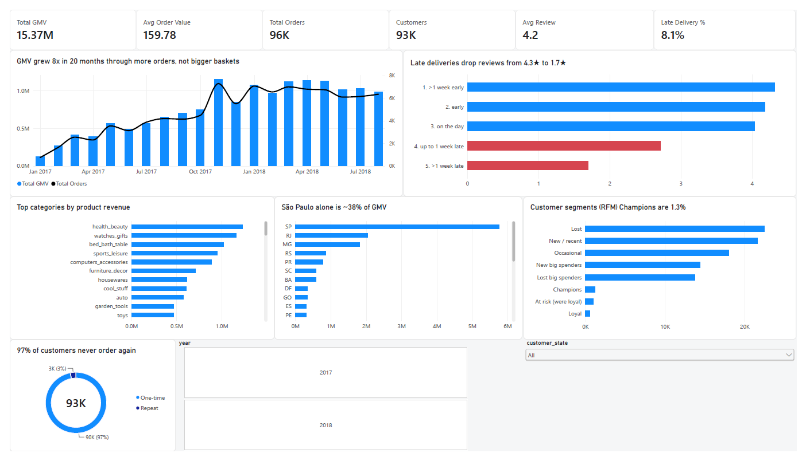

# Olist E-Commerce Analytics and Visualization

End-to-end analytics project on the [Olist Brazilian E-Commerce dataset](https://www.kaggle.com/datasets/olistbr/brazilian-ecommerce)
(~100k orders, 9 relational tables, 2016–2018), built in **PostgreSQL** and visualised in **Power BI**.

The project covers the full analyst workflow: schema design → bulk load → data profiling → cleaning layer →
business questions → advanced analysis (cohorts, RFM, funnel, window functions) → star schema → executive dashboard.



---

## Headline numbers (delivered orders, Jan 2017 – Aug 2018)

| Orders | Customers | Active sellers | GMV | Avg order value | Avg review | Late deliveries | Avg delivery time |
|---|---|---|---|---|---|---|---|
| 96,203 | 93,096 | 2,945 | R$ 15.37M | R$ 159.78 | 4.16 / 5 | 8.1% | 12.5 days |

---

## Key findings

**1. Late delivery is the main driver of bad reviews.**
Orders delivered early average **4.3★**. Up to a week late: **2.7★**. More than a week late: **1.7★**, with 79% of those
customers giving 1–2 stars. Lateness affects only 8% of orders but accounts for almost all low reviews.
Review scores dipped to 3.8–4.0 in Nov 2017 (Black Friday volume) and Feb–Mar 2018 (postal strike), both delivery-driven.
*(sql/06 Q6, sql/08 monthly table)*

**2. Growth came from order volume, not basket size.**
Monthly GMV grew ~8× from Jan 2017 (R$ 127k) to a ~R$ 1.0–1.1M run-rate in 2018, while average order value stayed flat
at ~R$ 160 for the entire period. Black Friday 2017 produced the single biggest month: 7,288 orders, +63% MoM.
*(sql/06 Q1, sql/07 A1–A2)*

**3. Olist does not retain customers.**
97.0% of customers placed exactly one order. Repeat customers (3.0%) spend ~2× more over their lifetime
(R$ 309 vs R$ 161). Monthly cohort retention is **below 1% in every cell** of the cohort matrix. Worse, 30.5% of
"second purchases" happen within one day of the first — split checkouts, not loyalty — so true repeat behaviour
is closer to 2%. *(sql/06 Q11, sql/07 A3–A4)*

**4. Revenue is concentrated.**
São Paulo state alone is ~38% of GMV. The top 10% of sellers generate 67% of GMV; the top 1% (44 sellers) generate 31%.
*(sql/06 Q3, sql/07 A8)*

**5. The carrier leg is the bottleneck.**
Of 12.5 average delivery days, 9.4 are spent between carrier hand-off and the customer's door; approval takes 9.6 hours
and seller processing 2.8 days. The fulfilment funnel itself is healthy (97.1% of purchased orders are delivered).
*(sql/07 A6)*

**6. RFM segmentation shows where the money is.**
"New big spenders" (15.5% of customers) and "Lost big spenders" (14.8%) together hold **56% of GMV**.
"Champions" — recent *and* repeat — are just 1.3% of customers. *(sql/07 A5)*

### Recommendations
1. **Fix lateness before anything else** — set carrier SLAs, and start with the ten large sellers in `sql/07 A9`
   that run 15–24% late (the worst: 389 orders, 23.6% late).
2. **Target "New big spenders" with a second-purchase campaign** within 30 days — high value, still recent, 28% of GMV.
3. **Report true repeat rate** excluding same-day split checkouts; the headline 3% overstates loyalty.
4. **Plan Black Friday capacity** — the Nov 2017 spike doubled volume and cost ~0.3★ in reviews.

---

## Data quality findings (from `sql/03` and `sql/05`)

| Finding | Decision |
|---|---|
| `customer_id` is per *order*; `customer_unique_id` is the *person* (99,441 vs 96,096) | All customer metrics grouped by `customer_unique_id` |
| 775 orders have no items (603 `unavailable`, 164 `canceled`) | Kept in raw data; excluded from analysis by the `delivered` filter |
| One order can have up to 29 payment rows | Aggregated to one row per order (`v_order_payments_agg`) before any join — avoids fan-out |
| `order_reviews` has no unique column (`review_id` and `order_id` both repeat) | Surrogate key added; `v_order_reviews_latest` keeps one review per order |
| Geolocation has 52.6 points per zip prefix; 42 points outside Brazil | Collapsed to `geo_zip` (one averaged coordinate per zip, Brazil bounding box) |
| Zip prefixes have leading zeros (`01037`) | Stored as `CHAR(5)`, never integer |
| 2 product categories missing from the translation file | Added |
| 264 orders paid more than price + freight | Installment interest — not an error. Two revenue definitions kept: **GMV** (items) and **cash collected** (payments) |
| Thin months at the edges (Sep–Dec 2016, Sep–Oct 2018) | Analysis window fixed to 2017-01 → 2018-08 in `v_orders_clean` |
| 166 orders handed to carrier before purchase timestamp; 8 delivered orders without a delivery date | Source-system glitches, documented and excluded where relevant |

Principle used throughout: **raw tables are never updated or deleted.** Cleaning is additive — keys, lookup tables and views.

---

## Repository structure

```
├── data/                      # Olist CSVs (not committed — download from Kaggle, see below)
├── sql/
│   ├── 01_create_database.sql # CREATE DATABASE
│   ├── 02_create_tables.sql   # DDL: 9 tables, PKs/FKs, composite keys, indexes
│   ├── 03_profiling.sql       # COUNT vs COUNT DISTINCT profiling of every table
│   ├── 04_load_data.sql       # \copy bulk load, parents first, row-count verification
│   ├── 05_data_cleaning.sql   # quality checks + additive cleaning layer (views, geo_zip)
│   ├── 06_business_questions.sql  # 12 business questions (joins across 3–4 tables)
│   ├── 07_advanced_analysis.sql   # LAG/LEAD, window frames, cohorts, RFM (NTILE), funnel, DENSE_RANK
│   ├── 08_star_schema.sql     # dw schema: 4 dims + 2 facts, reconciled to the cent
│   └── *_output.txt           # saved output of each script
├── dashboard/
│   ├── brazilian_e_commerce_visualization.pbix
│   ├── executive_overview.png
│   └── BI.pdf
└── README.md
```

## Star schema (schema `dw`)

```
                     dim_date (1,096 days)
                          │
dim_customer (93,096) ── fact_orders (96,203)      grain: one delivered order
 + RFM segment, lat/lng       │                     payments, review, delivery pre-aggregated
                              │
                     fact_order_items (109,872)    grain: one order line
                       │              │
             dim_product (32,951)  dim_seller (3,095)
```
`08_star_schema.sql` ends with a reconciliation block: the star reproduces the Step-6 KPIs exactly
(96,203 orders · GMV 15,371,741.09 · cash 15,374,496.52) and every fact key resolves to a dimension row.

---

## How to reproduce

Requirements: PostgreSQL 14+ (`psql` on PATH), Power BI Desktop (optional, for the dashboard).

```powershell
# 1. Download the 9 CSVs from Kaggle into .\data\
# 2. From the project folder:
psql -U postgres -d postgres              -f .\sql\01_create_database.sql
psql -U postgres -d brazilian_e_commerce  -f .\sql\02_create_tables.sql
psql -U postgres -d brazilian_e_commerce  -f .\sql\04_load_data.sql
psql -U postgres -d brazilian_e_commerce  -f .\sql\03_profiling.sql        -o .\sql\03_profiling_output.txt
psql -U postgres -d brazilian_e_commerce  -f .\sql\05_data_cleaning.sql    -o .\sql\05_data_cleaning_output.txt
psql -U postgres -d brazilian_e_commerce  -f .\sql\06_business_questions.sql -o .\sql\06_business_questions_output.txt
psql -U postgres -d brazilian_e_commerce  -f .\sql\07_advanced_analysis.sql -o .\sql\07_advanced_analysis_output.txt
psql -U postgres -d brazilian_e_commerce  -f .\sql\08_star_schema.sql      -o .\sql\08_star_schema_output.txt
# 3. Open the .pbix, point the PostgreSQL source at localhost / brazilian_e_commerce, refresh.
```

## SQL techniques used

Composite primary keys · foreign keys and load ordering · `\copy` bulk load · `COUNT(*)` vs `COUNT(DISTINCT)` profiling ·
CTEs · multi-table joins (up to 4) · fan-out prevention by pre-aggregation · `FILTER (WHERE …)` · percent-of-total with
`SUM() OVER ()` · `LAG` / `LEAD` · window frames (`ROWS BETWEEN`) · `ROW_NUMBER` / `DENSE_RANK` / `NTILE` ·
`PERCENTILE_CONT` · `MODE() WITHIN GROUP` · `ARRAY_AGG` · `DISTINCT ON` · `GENERATE_SERIES` date dimension ·
views vs materialised tables · star-schema modelling · reconciliation tests.

## Tools
PostgreSQL 17 · psql · Power BI Desktop (DAX measures: `DIVIDE`, `CALCULATE`, `DISTINCTCOUNT`)

## Data source
Olist, *Brazilian E-Commerce Public Dataset*, Kaggle (CC BY-NC-SA 4.0).
